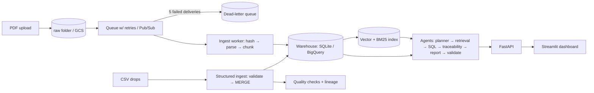

# Engineering Intelligence & Traceability Platform

Ingests engineering PDFs and test records, answers engineering questions with cited evidence,
and traces requirements → tests → results → failures → change requests. Bad data is caught by
quality checks; every record and chunk has lineage; bad files land in a dead-letter queue.

> **All data is fictional** ("Program Halcyon"). It's generated by `data/generate.py` so eval
> ground truth is known exactly. The pipeline accepts any PDF dropped into `data/raw/`.

Runs end to end on a laptop. The "Local → GCP mapping" section shows the managed service each
local component corresponds to.

## Architecture



## Run it

```bash
python3 -m venv .venv && source .venv/bin/activate
pip install -r requirements.txt -r requirements-dev.txt
make all        # generate data, ingest, build index
make test       # 24 tests incl. failure injection
make gate       # retrieval + agent evals, fails if below thresholds
make demo
make api        # terminal 1  -> http://localhost:8000/docs
make dashboard  # terminal 2  -> http://localhost:8501
```
Optional: `export GEMINI_API_KEY=...` switches planning, NL→SQL and answer writing to Gemini
(validated against evidence, with extractive fallback). `EMBEDDER=sbert` and `RERANK=1` need
`pip install sentence-transformers`; then `make index && python evals/run_evals.py --rerank`.

## Results (synthetic corpus, extractive mode, no LLM)

| Retrieval mode (32 questions) | recall@5 | MRR |
|---|---|---|
| dense (LSA) | 1.00 | 0.91 |
| BM25 | 1.00 | 0.92 |
| hybrid (RRF) | 1.00 | 0.91 |

The corpus is small (38 chunks) and the questions were written with knowledge of the documents, so
retrieval is saturated: this table can't show what hybrid search or reranking contribute. A larger
real corpus (e.g. public NASA technical reports) is needed for that comparison.

| Agent eval (15 cases) | Pass |
|---|---|
| Traceability | 4/4 |
| Structured (SQL) | 2/2 |
| Document Q&A | 3/4 |
| Cross-source | 2/2 |
| Unanswerable (must refuse) | 3/3 |

| Answering mode | Agent eval |
|---|---|
| Extractive (no LLM) | 14/15 |
| Gemini, coverage-filtered evidence | 13/15 |
| Gemini, all top retrieved passages | 15/15 (unanswerable questions still refused 3/3) |

The HV-7 question ("what caused the failures?") has an answer ("fretting corrosion") that shares
no words with it. The coverage filter dropped that passage before the model saw it, so the
bottleneck was evidence selection, not answer writing.


## Design decisions
- **Content hash = document identity.** Duplicate uploads are skipped; retries are safe.
- **Upserts everywhere** (SQLite `ON CONFLICT`, = BigQuery `MERGE`) and deterministic chunk IDs.
- **Checkpointed backfill** resumes after a crash; hashing covers the gap when the checkpoint lags.
- **Traceability is SQL, not LLM.** The agent decides what to trace; a recursive CTE does it.
- **SQL guard + read-only connection** for any model-written SQL (defense in depth).
- **Validator** rejects answers citing unknown evidence or mentioning IDs absent from evidence; an
  ungrounded LLM answer falls back to the extractive answer.
- **Contextual chunk headers** (doc title + section on every chunk).
- **Orphans are loaded but flagged**; rows missing required fields are rejected; malformed files
  are rejected whole.

## Local → GCP mapping
| Local | GCP |
|---|---|
| `data/raw/` | GCS bucket + OBJECT_FINALIZE notification |
| `LocalQueue` | Pub/Sub push subscription, retry policy, dead-letter topic |
| `ingest.handle()` | Cloud Run `/pubsub` endpoint |
| SQLite | BigQuery `eng_intel` (MERGE) |
| pickle index | Qdrant / Vertex AI Vector Search |
| LSA embedder | Vertex AI text embeddings |
| `needs_ocr` flag | Document AI OCR processor |
| JSON logs | Cloud Logging + Cloud Trace (OpenTelemetry) |

## Limitations
- Synthetic corpus; retrieval results are saturated (see above).
- Local only: the GCP mapping above is a design, not a deployment.
- Scanned pages are flagged for OCR but not processed; diagrams are not interpreted.
